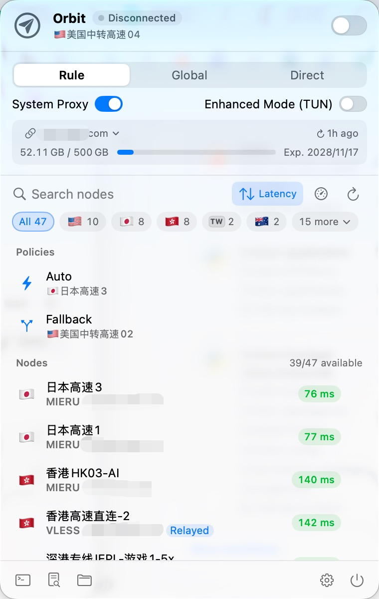

# Orbit

English | [简体中文](README.zh-CN.md)

A macOS menu bar proxy client for connecting to proxy servers you are authorized to use. It parses subscriptions, tests node latency, offers Rule / Global / Direct modes, and supports both the system proxy and Enhanced Mode (TUN). Under the hood it runs the open-source [mihomo](https://github.com/MetaCubeX/mihomo) core, built from source and bundled into the app.

Orbit itself does not provide any nodes, subscriptions or proxy service.

<p align="center"></p>

## Protocols and subscription compatibility

- Supports mieru, VLESS (including Reality), VMess, Trojan, Shadowsocks, Hysteria2, TUIC, AnyTLS, SOCKS5, HTTP and more.
- Understands several common share-link variants, including `mierus://` and `vless://` links whose whole authority part is base64-encoded (mihomo's own parser can't handle those).
- Some providers return different node lists depending on the User-Agent. By default Orbit sends its own UA (`Orbit/1.0 (mihomo; clash.meta)`, asking for the Clash Meta format). If nodes are missing, pick another client's UA from **Presets** in the source editor. The client names in that list only describe which format to request; Orbit is not affiliated with them.
- No GEOIP / GEOSITE databases needed: rule sets ship with the app and are updated through the proxy afterwards, so the first launch needs no extra downloads.

## Install

Download `Orbit-<version>-<arch>.zip` from Releases (arm64 for Apple Silicon, x86_64 for Intel), unzip it and drag Orbit.app into Applications.

Orbit is only ad-hoc signed and not notarized by Apple, so the first launch shows a warning that the developer can't be verified. Once you're sure the download came from this repository, allow it in either way:

- Open **System Settings → Privacy & Security**, find Orbit near the bottom and click **Open Anyway**.
- Or run in Terminal:

```bash
xattr -dr com.apple.quarantine /Applications/Orbit.app
```

You can also build it yourself (see [Build](#build)); a locally built app is not blocked.

## Usage

```bash
open /Applications/Orbit.app
```

- Click the paper-plane icon in the menu bar to open the panel. The switch in the top-right corner connects and disconnects; the label next to "Orbit" shows Connected / Disconnected / Connecting.
- Once connected, Orbit turns on the system proxy (HTTP + SOCKS5 at `127.0.0.1:7890`) and restores it when the app quits.
- **Enhanced Mode (TUN)** takes over all traffic, so programs that ignore the system proxy (terminals, games) are proxied too. Turning it on asks for an administrator password; the core then runs as root and stops automatically when the app quits. To keep other programs on the Mac from using this to gain root:
  - The root core runs only inside the root-owned directory `/Library/Application Support/Orbit/`. The launcher reads the core, config and rule sets with the current user's permissions and copies them in; while running, it never reads or writes the user's directories. Its log is written there too and is readable only by the current user.
  - The copied core and config must match the SHA-256 hashes computed by the app, or the launcher refuses to start. The core's hash is written into Info.plist at build time.
  - The root core's control API uses a one-time secret generated by the launcher. Only the app knows it; it is never written to a file.
  - The core is patched to remove the `/restart` and `/upgrade` endpoints.
- Click the gauge icon to test every node, ⇅ to sort by latency, or right-click a node to test just that one.
- Below the search box is a region filter: **All** plus the 5 regions with the most nodes; the rest are under **more**. Click the selected region again to clear the filter. While filtering or searching, the **Policies** group is hidden. After a test, the **Nodes** header shows how many work (e.g. 41/47 available).
- Flags the system can't display are replaced with a small two-letter region code tag.
- Messages float above the bottom of the node list without pushing the panel around. Normal messages disappear after 3 seconds; errors stay until you close them.
- The terminal button copies `export https_proxy=...` for pasting into a shell.
- When connected, the right side of the speed row shows the exit IP (flag, city, full IP). Long city names are truncated but the IP is always shown in full. Click to copy the IP; hover to see location, ISP and ASN. The exit IP is looked up once when you connect or change node or mode, and on demand with ⟳; it is never polled. Orbit tries ip-api.com, ipwho.is, api.ip.sb and ipinfo.io in turn (free services often rate-limit shared exit IPs, hence several), and these domains are always sent through the proxy. ip-api.com's free tier is http only, so the app's Info.plist makes an exception for it.
- **Node sources** are managed under **Settings → General**. You can keep several and use one at a time.
  - Three kinds: subscription URL (with its own User-Agent and auto-update interval), imported file, pasted nodes.
  - Supported formats: share-link lists (plain or base64), Clash / mihomo YAML (`proxies:`), sing-box JSON (`outbounds`), SIP008 JSON. Subscription URLs returning any of these work too.
  - A source is parsed before it's added. If it has no usable nodes it isn't added, and Orbit says what it found instead (for example "Got a web page instead of a node list").
  - Click the circle to the left of a source to switch to it. With several sources, the source name on the panel's subscription card is a switch menu too. Switching, adding and deleting take effect immediately, without **Save**.
  - Imported files and pasted nodes are copied into the data directory, so moving the original file later doesn't matter. They don't need "update subscription"; to change nodes, edit or re-import them.
  - When a node name has no flag, its region is guessed from place names or codes in the name (such as "Hong Kong 01", "HK-02", "Tokyo"). This drives the region filter and same-region relays.
- Settings has 4 pages:
  - General: node sources, connect on launch, open at login.
  - Network: ports, LAN connections, latency test URL. Once LAN connections are allowed, other devices must connect to the proxy port with a user name and password (the password is random by default; you can change or regenerate it). Connections from this Mac need no password.
  - Rules: ad blocking, custom rules (one mihomo rule per line, taking priority over the built-in rules).
  - Appearance: language (System / 中文 / English), theme (System / Light / Dark), whether to show node IPs, and live speed in the menu bar.
  - Live speed in the menu bar is off by default. When on and connected, upload and download speeds appear to the right of the menu bar icon (two small lines, fixed width).
  - After a change, the **Save** button at the bottom turns to the accent color. ⌘S saves and **Revert** discards. Closing the window with unsaved changes asks first.
  - With language set to System, Orbit shows Chinese if the system's preferred language is Chinese, and English otherwise.
- Opening the app doesn't update subscriptions or test nodes. Tests run only when you click the test button or after you update a subscription manually. Subscriptions update only when you click ↻ or when the current source's auto-update interval comes around (0–168 hours, 0 is off; set it in the source editor). Adding a new source triggers one test, like a manual update. Scheduled updates only refresh the node list and never start a test.

Command-line tool (shares the data directory with the app):

```bash
dist/orbitctl sub <url>         # add a subscription URL and make it current (edits it if the current source is a subscription)
dist/orbitctl import <file>     # import a node file and make it current
dist/orbitctl sources           # list node sources (* marks the current one)
dist/orbitctl use <index|name>  # switch source
dist/orbitctl update            # re-fetch the current source
dist/orbitctl nodes             # list parsed nodes
dist/orbitctl config            # generate and validate the mihomo config
dist/orbitctl test              # test all nodes
dist/orbitctl run               # run the core in the foreground without touching the system proxy (--system-proxy to set it)
dist/orbitctl select <node>     # select a node (core must be running)
dist/orbitctl ip                # look up the exit IP through the proxy port (core must be running)
```

Data directory: `~/Library/Application Support/Orbit/`, holding settings.json, `sources/` (each source's raw content and parsed nodes), the generated config.yaml and core.log. Set `ORBIT_HOME` to make the app and CLI use a different directory. If settings.json, or any source in it, can't be read, the original file is first backed up as `settings.json.broken-<timestamp>` rather than overwritten. A single subscription from older versions (subscriptionURL and nodes.json in settings.json) is migrated to the first source on first launch.

## Build

Requirements: macOS 13 or later, Xcode 15 or later (Swift 5.9+; Command Line Tools alone is fine), python3. The app is built for the architecture of the Mac you build on.

```bash
./scripts/build-app.sh
```

- On the first run, `scripts/build-core.sh` downloads Go (sha256-checked), fetches the mihomo source through the Go module proxy (verified by GOSUMDB) and builds it. It defaults to golang.google.cn and goproxy.cn; use the `GO_DL_BASE` (e.g. `https://go.dev/dl`), `GOPROXY` and `GOSUMDB` environment variables to use other hosts.
- The patches in `patches/` are applied before building: one adds a `resolve-local` option for mieru nodes, the other removes the `/restart` and `/upgrade` endpoints. When the patches or `build-core.sh` change, `build-app.sh` rebuilds the core automatically.
- The patched core source is packed as `.toolchain/mihomo-<version>-orbit-src.tar.gz`.
- After a test, Orbit checks failed nodes for two fixable cases:
  - The server can't resolve domain names (works by IP, fails by domain): resolve the IP locally and send that instead (mieru only). This is stored as `resolveLocal` in settings.json and the node shows **Local DNS**.
  - This Mac can't reach the server's IP, but other nodes can: route it through the RELAY group (preferring nodes in the same region). This is stored as `chainVia` and the node shows **Relayed**.
  - Fixes are recorded by node name, so nodes added to the subscription later go through the same check.
  - Each test decides the flags afresh: flagged nodes are always re-tested once without the fix. If the direct path works, the flag is removed; if only the fixed path works, it stays; if neither works, it's removed too. A one-off timeout lasts at most until the next test.
  - No checks in TUN mode, since TUN captures the temporary test core's traffic and the results would be wrong.
- The source of [Yams](https://github.com/jpsim/Yams) 6.2.2, used for YAML parsing, is vendored in `Vendor/Yams/` (MIT), so builds don't need GitHub.
- Output: `dist/Orbit.app`, `dist/orbitctl`.
- When building the core, `scripts/gen-core-licenses.py` collects the licenses of the Go modules actually compiled into it. `build-app.sh` puts that file, `LICENSE`, `THIRD_PARTY_NOTICES.md` and the Yams / libyaml licenses into `Orbit.app/Contents/Resources/Licenses/`, viewable from **Settings → General → Open Source Licenses…**.
- The app icon is generated by `swift scripts/render-icon.swift`; every shape is drawn by hand, with no SF Symbols.
- After building, the app is installed to `/Applications/Orbit.app`: a running Orbit is quit first and reopened afterwards. If Orbit is connected, installation is skipped to avoid cutting your connection (disconnect, then run `ditto dist/Orbit.app /Applications/Orbit.app`). Set `ORBIT_NO_INSTALL=1` to skip installing.
- Release: `./scripts/package.sh` creates `dist/Orbit-<version>-<arch>.zip` (packed with `ditto` to keep the signature intact), the core source tarball and `SHA256SUMS`; upload all three to the Release.
- Tests: `swift test`

## Code layout

- `Sources/OrbitCore/ProxyNode.swift`: share-link parsing (mieru / vless / vmess / trojan / ss / hysteria2 / tuic / anytls / socks / http, both the standard and Shadowrocket formats)
- `Sources/OrbitCore/Subscription.swift`: subscription fetching, traffic and expiry info
- `Sources/OrbitCore/NodeFormats.swift`: detecting and parsing subscription / file formats (share links, Clash YAML, sing-box, SIP008)
- `Sources/OrbitCore/Region.swift`: guessing regions from node names
- `Sources/OrbitCore/ConfigBuilder.swift`: generating the mihomo config (routing rules, DNS, TUN, policy groups)
- `Sources/OrbitCore/CoreProcess.swift`: core process management; in TUN mode an inline root launcher runs the core in a root-owned directory, with a watchdog
- `Sources/OrbitCore/MihomoAPI.swift`: mihomo REST API client
- `Sources/OrbitCore/ExitIP.swift`: exit IP lookup through the proxy
- `Sources/OrbitApp/`: SwiftUI menu bar UI (`Flag.swift` checks whether flags can be displayed)
- `Sources/orbitctl/`: command-line tool

## Privacy and third-party services

Orbit has no analytics, telemetry or reporting of any kind. It only goes online to:

- Fetch the subscription URLs you add (https only, and redirects to http are not followed; if a direct fetch fails, it retries through the proxy).
- Look up the exit IP after connecting: ip-api.com, ipwho.is, api.ip.sb and ipinfo.io are tried in turn, and these services see your exit IP. The free tiers of ip-api.com and ipwho.is are for non-commercial use only.
- DNS over HTTPS: Alibaba (223.5.5.5) and Tencent (doh.pub) for mainland China domains; Cloudflare (1.1.1.1) and Google (8.8.8.8) through the proxy for everything else.
- Update rule sets: downloaded through the proxy from `raw.githubusercontent.com/MetaCubeX/meta-rules-dat`.

Subscriptions, nodes and settings are stored only in the local data directory.

## Intended use and disclaimer

- Orbit is a general-purpose proxy client for connecting to proxy servers you are authorized to use, such as your own server or a proxy provided by your company or school. It can also be used to learn about network protocols.
- Orbit does not provide any nodes, subscriptions or proxy service, and is not affiliated with any proxy provider.
- Follow the laws and regulations where you are, and the terms of your network and service providers. How you use Orbit is your decision and your responsibility.
- Orbit is provided as is, without warranty of any kind; the authors are not liable for any damage from using it (see sections 15 and 16 of the GPL v3).

## Security notes

- **Node operators can see your traffic.** They see the addresses you visit and any unencrypted content. Only use nodes and subscriptions you trust.
- **Enhanced Mode (TUN) runs the core as root.** It needs an administrator password; turn it off when you don't need it. The [Usage](#usage) section lists what Orbit does to protect it. But the app lives where the current user can write, so malware already on the Mac could replace the whole app and gain root the next time you enter your password. Every app without a privileged helper shares this limitation.
- **LAN sharing opens the proxy port to devices on the same network.** Don't turn it on in public networks, and don't share the password.
- **Connecting looks up your exit IP with third-party services**; see [Privacy and third-party services](#privacy-and-third-party-services).
- **The app is not notarized by Apple.** Download it only from this repository's Releases and check it against `SHA256SUMS`, or build it yourself.
- Report security issues privately as described in [SECURITY.md](SECURITY.md).

## License

Orbit is released under the [GNU GPL v3](LICENSE), without any warranty. Every Release includes the full source of the patched mihomo core. Components bundled in the app and their licenses are listed in [THIRD_PARTY_NOTICES.md](THIRD_PARTY_NOTICES.md): the mihomo core and mieru (GPL-3.0), rule sets (GPL-3.0), Yams and libyaml (MIT), the Go runtime (BSD-3-Clause), and more.

Shadowrocket, Clash, sing-box, v2rayN and other names are trademarks of their respective owners, used here only to describe compatibility. Orbit is not affiliated with them.
