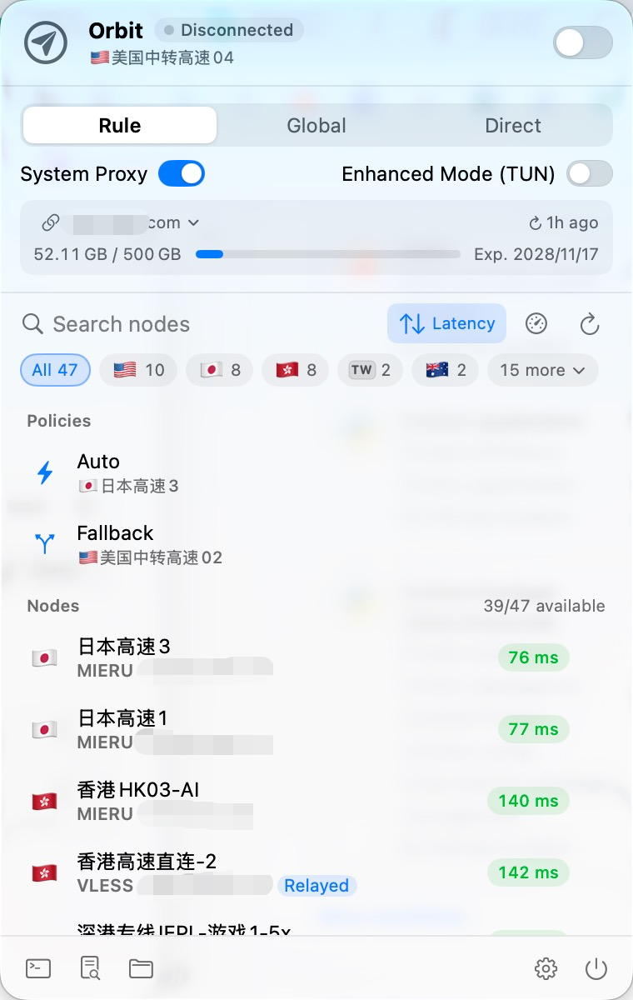

# Orbit

[English](README.md) | 简体中文

macOS 菜单栏网络代理客户端，用来连接你有权使用的代理服务器。支持订阅解析、节点测速、规则 / 全局 / 直连三种模式、系统代理和增强模式 (TUN)。底层是开源的 [mihomo](https://github.com/MetaCubeX/mihomo) 内核，从源码编译后打包进 app。

Orbit 本身不提供任何节点、订阅或代理服务。

<p align="center"></p>

## 协议与订阅兼容性

- 支持 mieru、VLESS（含 Reality）、VMess、Trojan、Shadowsocks、Hysteria2、TUIC、AnyTLS、SOCKS5、HTTP 等协议。
- 能解析几种常见的分享链接写法，包括 `mierus://` 和 authority 部分整体做 base64 编码的 `vless://`（mihomo 自带的解析器处理不了这种 vless）。
- 有些服务商按 User-Agent 返回不同的节点列表。Orbit 默认用自己的 UA（`Orbit/1.0 (mihomo; clash.meta)`，请求 Clash Meta 格式）；节点不全时，可以在来源的编辑窗口里从「预设」换成其他客户端的 UA。预设里列出的客户端名称只用来说明请求哪种格式，Orbit 和它们没有关系。
- 不依赖 GEOIP / GEOSITE 数据库：规则集随 app 打包，之后经代理自动更新，第一次启动不需要额外下载。

## 安装

从 Releases 下载 `Orbit-<版本>-<架构>.zip`（arm64 为 Apple Silicon，x86_64 为 Intel），解压后把 Orbit.app 拖进「应用程序」。

Orbit 只做了临时签名（ad-hoc），没有经过 Apple 公证，第一次打开时 macOS 会提示无法验证开发者。确认下载来源可信后，任选一种方式放行：

- 打开「系统设置 → 隐私与安全性」，在页面下方找到 Orbit，点「仍要打开」。
- 或者在终端运行：

```bash
xattr -dr com.apple.quarantine /Applications/Orbit.app
```

也可以按下面「构建」一节自己编译，自己编译的版本不会被拦截。

## 使用

```bash
open /Applications/Orbit.app
```

- 点菜单栏的纸飞机图标打开面板，右上角开关负责连接/断开，「Orbit」旁的状态标签显示已连接 / 未连接 / 连接中。
- 连接后开启系统代理（HTTP + SOCKS5，地址 `127.0.0.1:7890`）。退出 app 时会自动恢复。
- **增强模式 (TUN)**：接管全部流量，终端、游戏这类不走系统代理的程序也能代理。开启时需要输入管理员密码，内核会以 root 身份运行，app 退出后自动停止。为了不让本机其他程序借机拿到 root 权限：
  - root 内核只在 root 专属目录 `/Library/Application Support/Orbit/` 里运行。启动脚本以当前用户的权限读取内核、配置和规则集，再复制进去；运行中不读写用户目录。日志也写在那里，只有当前用户能读。
  - 复制进去的内核和配置必须和 app 算出的 SHA-256 一致，否则拒绝启动。内核的哈希在构建时写进 Info.plist。
  - root 内核的控制接口使用启动脚本临时生成的一次性密钥，只有 app 知道，不写入任何文件。
  - 内核打了补丁，去掉了 `/restart` 和 `/upgrade` 两个接口。
- 点测速图标（仪表盘）测速全部节点，点 ⇅ 按延迟排序，右键单个节点可以单独测速。
- 搜索框下面是地区筛选：「全部」加节点最多的 5 个地区，其余地区点「更多」展开；再点一次已选中的地区取消筛选。筛选或搜索时隐藏「策略」分组。「节点」标题右侧显示测速后的可用数（如 41/47 可用）。
- 系统不显示的国旗（中国大陆地区的系统不显示 🇹🇼）会自动改为两个字母的地区代码小标签。
- 提示消息浮在节点列表底部，不会挤动面板：普通提示 3 秒后自动消失，错误提示保留到手动关闭。
- 终端按钮会复制 `export https_proxy=...`，粘贴到 shell 里用。
- 连接后，顶部速度那一行右侧显示出口 IP（国旗、城市、完整 IP）。城市名过长时会缩略，IP 始终完整显示；点击复制 IP，悬浮查看位置、运营商、ASN。出口 IP 只在连接、切换节点或模式时查询一次，也可以点 ⟳ 手动刷新，不会定时轮询。依次尝试 ip-api.com、ipwho.is、api.ip.sb、ipinfo.io（免费服务常对共享出口 IP 限流，所以准备了多个），这些域名强制走代理；ip-api.com 免费版只有 http，app 的 Info.plist 单独放行了它。
- **节点来源**：在「设置 → 通用」里管理，可以保存多个来源，同一时间使用其中一个。
  - 三种来源：订阅地址（可设 User-Agent 和自动更新间隔）、导入文件、粘贴节点。
  - 支持的格式：分享链接列表（明文或 base64）、Clash / mihomo YAML（`proxies:`）、sing-box JSON（`outbounds`）、SIP008 JSON。订阅地址返回这些格式也都能识别。
  - 添加前会先解析，没有可用节点就不添加，并说明识别到的是什么（比如「返回的是网页而不是节点列表」）。
  - 点来源左侧的圆圈切换；有多个来源时，面板订阅卡片上的来源名也是切换菜单。切换、添加、删除立即生效，不经过「保存」。
  - 导入文件和粘贴节点的内容会复制进数据目录，原文件之后移走也不影响；它们不需要「更新订阅」，要换节点就编辑或重新导入。
  - 节点名没有国旗时，按名字里的地名或代码识别地区（如「香港 01」「HK-02」「Tokyo」），用于地区筛选和同地区中转。
- 设置窗口分 4 页：
  - 通用：节点来源、启动时自动连接、登录时启动。
  - 网络：端口、局域网连接、测速地址。允许局域网连接后，其他设备必须用用户名和密码连接代理端口（密码默认随机生成，可以改或重新生成），本机连接不需要密码。
  - 规则：广告屏蔽、自定义规则（每行一条 mihomo 规则，优先于内置规则）。
  - 外观：界面语言（跟随系统 / 中文 / English）、外观（跟随系统 / 浅色 / 深色）、是否显示节点 IP、菜单栏实时网速。
  - 菜单栏实时网速默认关闭；打开后，连接时菜单栏图标右侧显示上传、下载速度（两行小字，宽度固定）。
  - 改动后底部的「保存」按钮会变成强调色，⌘S 保存，「还原」放弃改动；有未保存的改动时关闭窗口会先询问。
  - 语言选「跟随系统」时：系统首选语言是中文就显示中文，否则显示英文。
- 打开 app 不会自动更新订阅或测速。测速只在手动点测速按钮或手动更新订阅后进行；订阅只在手动点 ↻ 或到了当前来源的自动更新间隔时更新（0–168 小时，0 为关闭；在来源的编辑窗口里设置）。添加新来源后会自动测速一次，和手动更新订阅一样。定时自动更新只刷新节点列表，不会触发测速。

命令行工具（数据目录和 app 共用）：

```bash
dist/orbitctl sub <url>        # 添加订阅地址并设为当前来源（当前来源是订阅地址时改为修改它）
dist/orbitctl import <文件>    # 导入节点文件并设为当前来源
dist/orbitctl sources          # 列出节点来源（* 为当前来源）
dist/orbitctl use <序号|名称>  # 切换来源
dist/orbitctl update           # 重新拉取当前来源
dist/orbitctl nodes            # 列出已解析的节点
dist/orbitctl config           # 生成并校验 mihomo 配置
dist/orbitctl test             # 全部节点测速
dist/orbitctl run              # 前台运行内核，不改系统代理（加 --system-proxy 则设置系统代理）
dist/orbitctl select <节点名>  # 选择节点（需内核在运行）
dist/orbitctl ip               # 经代理端口查询出口 IP（需内核在运行）
```

数据目录：`~/Library/Application Support/Orbit/`，包含 settings.json、`sources/`（每个来源的原始内容和解析出的节点）、生成的 config.yaml 和 core.log。环境变量 `ORBIT_HOME` 可以让 app 和命令行改用别的数据目录。settings.json 读不出来，或其中某个来源读不出来时，原文件会先备份为 `settings.json.broken-<时间戳>`，不会被直接覆盖。旧版本的单个订阅（settings.json 里的 subscriptionURL 和 nodes.json）在首次启动时自动迁移为第一个来源。

## 构建

需要：macOS 13 或更新、Xcode 15 或更新（Swift 5.9 以上；只装 Command Line Tools 也可以）、python3。在哪种架构的 Mac 上编译，就得到哪种架构的 app。

```bash
./scripts/build-app.sh
```

- 第一次运行时，`scripts/build-core.sh` 会下载 Go（校验 sha256），经 Go 模块代理拉取 mihomo 源码（由 GOSUMDB 校验）并编译。默认用 golang.google.cn 和 goproxy.cn，可以用环境变量 `GO_DL_BASE`（如 `https://go.dev/dl`）、`GOPROXY`、`GOSUMDB` 换成其他地址。
- 编译前会打上 `patches/` 里的补丁：给 mieru 节点加 `resolve-local` 选项；去掉 `/restart` 和 `/upgrade` 接口。补丁或 `build-core.sh` 有改动时，`build-app.sh` 会自动重新编译内核。
- 打过补丁的内核源码会打包成 `.toolchain/mihomo-<版本>-orbit-src.tar.gz`。
- 测速后，Orbit 会对失败的节点自动排查两种可修复的情况：
  - 服务器自己解析不了域名（直连 IP 能通、用域名就失败）：改为本地解析好 IP 再发给服务器（仅 mieru），记录在 settings.json 的 `resolveLocal`，节点显示「本地解析」。
  - 本机连不上服务器 IP，经其他节点却能连上：改为经 RELAY 组中转（优先同地区节点），记录在 `chainVia`，节点显示「经中转」。
  - 修复按节点名记录，订阅以后新增的节点也会走同样的排查。
  - 标记以每次测速的结果为准：已标记的节点每次都会去掉修复再单独测一次。直连能通就取消标记；只有修复后能通就保留；都不通也取消标记。偶发超时最多影响到下一次测速。
  - TUN 模式下不做排查，因为临时测速内核的流量会被 TUN 接管，结果不准。
- YAML 解析用的 [Yams](https://github.com/jpsim/Yams) 6.2.2 源码放在 `Vendor/Yams/`（MIT 协议），构建不需要访问 GitHub。
- 输出：`dist/Orbit.app`、`dist/orbitctl`。
- 编译内核时，`scripts/gen-core-licenses.py` 会按内核里实际编进去的 Go 模块收集它们的许可证；`build-app.sh` 把这份文件、`LICENSE`、`THIRD_PARTY_NOTICES.md` 和 Yams / libyaml 的许可证放进 `Orbit.app/Contents/Resources/Licenses/`，设置 → 通用 →「开源许可…」可以打开。
- app 图标由 `swift scripts/render-icon.swift` 生成，全部图形自己绘制，不使用 SF Symbols。
- 编译完成后会自动安装到 `/Applications/Orbit.app`：Orbit 正在运行就先退出，装好后重新打开；Orbit 已连接时不安装，避免断网（断开后手动运行 `ditto dist/Orbit.app /Applications/Orbit.app`）。设置 `ORBIT_NO_INSTALL=1` 可跳过安装。
- 发布：`./scripts/package.sh` 生成 `dist/Orbit-<版本>-<架构>.zip`（用 `ditto` 打包，避免破坏签名）、内核源码包和 `SHA256SUMS`，三者一起上传到 Release。
- 测试：`swift test`

## 代码结构

- `Sources/OrbitCore/ProxyNode.swift`：分享链接解析（mieru / vless / vmess / trojan / ss / hysteria2 / tuic / anytls / socks / http，兼容标准格式和 Shadowrocket 格式）
- `Sources/OrbitCore/Subscription.swift`：订阅拉取、流量和到期信息
- `Sources/OrbitCore/NodeFormats.swift`：识别订阅 / 文件格式并解析（分享链接、Clash YAML、sing-box、SIP008）
- `Sources/OrbitCore/Region.swift`：从节点名识别地区
- `Sources/OrbitCore/ConfigBuilder.swift`：生成 mihomo 配置（分流规则、DNS、TUN、策略组）
- `Sources/OrbitCore/CoreProcess.swift`：内核进程管理；TUN 模式下由内联的 root 启动脚本在 root 专属目录里运行内核，加看门狗
- `Sources/OrbitCore/MihomoAPI.swift`：mihomo REST API 客户端
- `Sources/OrbitCore/ExitIP.swift`：经代理查询出口 IP
- `Sources/OrbitApp/`：SwiftUI 菜单栏界面（`Flag.swift` 负责检测国旗能否显示）
- `Sources/orbitctl/`：命令行

## 隐私与第三方服务

Orbit 没有统计、遥测或任何上报。它只在以下情况访问网络：

- 拉取你添加的订阅地址（只支持 https，也不跟随跳转到 http 的重定向；直连失败时经代理重试）。
- 连接后查询出口 IP：依次尝试 ip-api.com、ipwho.is、api.ip.sb、ipinfo.io，这些服务会看到你的出口 IP。其中 ip-api.com 和 ipwho.is 的免费版只允许非商业使用。
- DNS over HTTPS：国内域名用阿里（223.5.5.5）、腾讯（doh.pub），境外域名经代理用 Cloudflare（1.1.1.1）、Google（8.8.8.8）。
- 规则集更新：经代理从 `raw.githubusercontent.com/MetaCubeX/meta-rules-dat` 下载。

订阅、节点和设置只保存在本机的数据目录里。

## 用途与免责声明

- Orbit 是通用的网络代理客户端，用来连接你有权使用的代理服务器，例如自己搭建的服务器、公司或学校提供的代理，也可以用来学习网络协议。
- Orbit 不提供任何节点、订阅或代理服务，和任何代理服务商都没有关系。
- 请遵守你所在地的法律法规，以及网络和服务提供方的使用条款。如何使用由使用者自己决定，并自行承担相应责任。
- Orbit 按原样提供，不附带任何形式的担保；作者不对使用 Orbit 造成的任何损失负责（详见 GPL v3 第 15、16 条）。

## 安全须知

- **节点运营方能看到你的流量。** 他们能看到你访问的地址，以及所有未加密的内容。只使用你信任的节点和订阅。
- **增强模式 (TUN) 会以 root 身份运行内核。** 开启时需要管理员密码，不用时建议关闭。上面「使用」一节写了 Orbit 为此做的防护。但 app 安装在当前用户可写的位置，本机已有恶意程序时，它可以替换整个 app，在你下次输入管理员密码时拿到 root 权限。这是所有没有特权辅助程序的 app 共同的局限。
- **局域网共享会把代理端口开放给同一网络里的设备。** 不要在公共网络上开启，也不要把密码告诉别人。
- **连接后会向第三方服务查询出口 IP**，见上面「隐私与第三方服务」一节。
- **app 没有经过 Apple 公证。** 只从本仓库的 Releases 下载，并用 `SHA256SUMS` 核对；或者自己编译。
- 发现安全问题请按 [SECURITY.md](SECURITY.md) 私下报告。

## 许可证

Orbit 按 [GNU GPL v3](LICENSE) 发布，不提供任何担保。每个 Release 都附带打过补丁的 mihomo 内核完整源码包。打包进 app 的组件及其许可证见 [THIRD_PARTY_NOTICES.md](THIRD_PARTY_NOTICES.md)：mihomo 内核和 mieru（GPL-3.0）、规则集（GPL-3.0）、Yams 和 libyaml（MIT）、Go 运行时（BSD-3-Clause）等。

Shadowrocket、Clash、sing-box、v2rayN 等名称是各自所有者的商标，这里只用来说明兼容性，Orbit 与它们没有关联。

